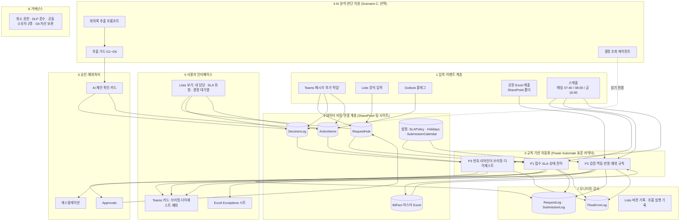
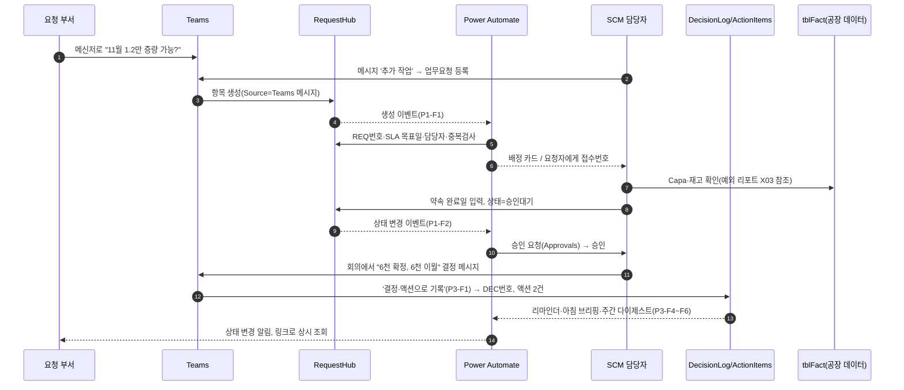
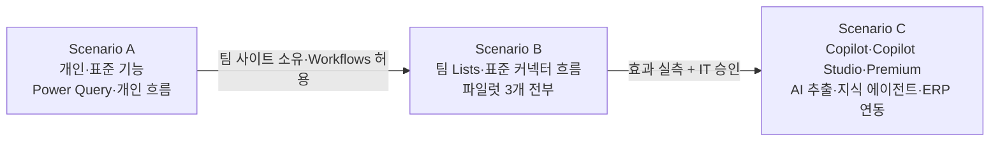

# 05. 통합 업무 자동화 아키텍처 — "SCM Work OS"

> 목표: 개별 자동화 도구 모음이 아니라, **이벤트 → 기록 → 규칙 → 예외 → 사람의 판단 → 기록**이 하나의 순환으로 도는 업무 운영체계.

---

## 1. 설계 원칙과 구현 방식

| 원칙 | 구현 방식(이 설계에서) |
|---|---|
| One Source of Truth | 업무 객체마다 원본 1개: 요청=RequestHub, 결정=DecisionLog, 액션=ActionItems, 주간 사실 데이터=tblFact. 메일·채팅은 원본이 아니라 **알림 채널** |
| Event-driven | 항목 생성·상태 변경·파일 제출·기한 도래(스케줄) 4종 이벤트가 모든 흐름의 시작점 |
| Human-in-the-loop | 수용·약속일·승인·결정·AI 제안 채택은 사람만. 흐름은 '대신 결정'하지 않고 '결정을 요청'한다 |
| Exception Management | 정상은 침묵. 담당자별 하루 1장 다이제스트, 예외 리포트는 High부터 |
| Traceability | RequestLog(요청 이벤트), Lists 버전 기록, Approvals 이력, SubmissionLog, FlowErrorLog |
| Reusability | 같은 패턴(Prev열 루프 차단·Try/Catch·다이제스트·ID 규칙)을 모든 목록에 재사용 → 새 업무는 '목록 + 정책 행' 추가로 확장 |
| Maintainability | 설정은 데이터(SLAPolicy, Holidays, SubmissionCalendar)로, 코드는 저장소로. 흐름 공동 소유자 2명 |

## 2. 전체 구조 (8계층)

## 3. 데이터 흐름 — 하나의 요청이 결정과 데이터로 이어지는 경로

## 4. 데이터 저장소 선정

| 기준 | Excel 표(SharePoint) | Microsoft Lists | SharePoint 라이브러리 | Dataverse | Dataverse for Teams |
|---|---|---|---|---|---|
| 데이터량 | 파일 25MB(커넥터)·스크립트 1회 5백만 셀 | 목록 3천만 항목, 보기·쿼리 5천 건 임계값 | 파일 단위 | 대용량 | 환경당 용량 제한 |
| 관계 구조 | 약함(수식) | 조회(Lookup) 열 수준 | 없음 | 강함(관계·키) | 강함 |
| 동시 편집 | 공동 작성 가능하나 스크립트·흐름 동시 쓰기 위험 | 항목 단위 안전 | 파일 체크아웃 | 행 단위 트랜잭션 | 행 단위 |
| 트랜잭션 안정성 | 낮음(동시성 1로 보완) | 중(항목 단위) | - | 높음 | 높음 |
| 권한 | 파일 단위 | 목록·항목 수준 | 폴더·파일 | 행 단위 보안 | 팀 단위 |
| 이력 | 파일 버전 | 항목 버전 기록 | 파일 버전 | 감사 로그 | 감사 |
| 라이선스 | 기본 | 기본 | 기본 | **Premium** | Teams 포함(제약) |
| 관리 비용 | 낮음 | 낮음 | 낮음 | 중~높음(환경·ALM) | 중 |
| **이 설계의 용도** | **주간 수치 사실 데이터(tblFact)** — 집계·피벗 친화 | **업무 객체(요청·결정·액션·로그·설정)** | **제출 파일·결정 근거 문서** | Phase 4 이후 tblFact 이전 후보(연 10만 행 초과 또는 ERP 연동 시) | 비채택(환경 관리 부담 대비 이득 작음) |

**이전 기준(Trigger to migrate):** tblFact가 10만 행 초과 / 스크립트 실행이 60초를 넘기 시작 / 행 단위 권한 필요 / ERP·APS 실시간 연동 승인 → Dataverse 또는 IT 관리 DB + Power BI.

## 5. 경량 아키텍처 (도구 최소화판) — "3 Lists + 1 Workbook + 6 Flows"

추가 라이선스 0, 관리자 권한 0(Workflows 앱 허용만 확인)으로 핵심 효과의 대부분을 내는 최소 구성이다.

| 구성 | 개수 | 내용 |
|---|---|---|
| Lists | 3 | RequestHub(요청), ActionItems(액션+회신대기), DecisionLog(결정) — 로그·설정은 각 목록의 열·보기로 단순화 |
| Workbook | 1 | SCM_Master_Fact.xlsx(tblFact, tblSKU, Exceptions) |
| Flows | 6 | ① 요청 접수 ② 상태 변경 ③ 일일 다이제스트(요청+액션 통합) ④ Teams 메시지 기록 ⑤ 제출 검증·반영 ⑥ 아침 브리핑 |
| 생략 | - | Approvals(상태+카드로 대체), RequestLog(버전 기록으로 대체), 예외 리포트 Flow(마스터 파일 열 때 수동 스크립트 실행) |

**트레이드오프:** KPI(리드타임·SLA 준수율) 산출이 버전 기록 수작업 추출에 의존 → 팀 확산(Phase 3) 시 정식 구성으로 승격.

## 6. 이벤트 카탈로그

| 이벤트 | 원천 | 처리 Flow | 결과 | 사람의 역할 |
|---|---|---|---|---|
| 요청 생성 | RequestHub | P1-F1 | 번호·SLA·담당·중복의심 | 내용 확인·약속일 |
| 요청 상태/약속일 변경 | RequestHub | P1-F2 | 전이 검사·승인·로그·알림 | 승인 |
| 매일 08:00 | 스케줄 | P1-F3 | SLA 다이제스트·에스컬레이션 | 재협의 |
| 메시지 선택 | Teams | P1-F4, P3-F1 | 요청/결정/액션 생성 | 분류 선택 |
| 파일 제출 | SharePoint 폴더 | P2-F1 | 검증→반려/반영 | 공장: 수정 재제출 |
| 마감 임박 | 스케줄 | P2-F2 | 미제출 공장만 리마인더 | - |
| 전 공장 제출 완료 | SubmissionCalendar | P2-F3 | 예외 리포트 게시 | **예외 해석·조치 결정** |
| 메일 플래그 | Outlook | P3-F3 | 액션/회신대기 등록 | 플래그만 |
| 액션 상태 변경 | ActionItems | P3-F2 | 번호·완료일 | - |
| 평일 07:40 | 스케줄 | P3-F4 | 아침 브리핑 | **오늘의 우선순위 선택** |
| 평일 08:30 | 스케줄 | P3-F6 | 액션 리마인더·에스컬레이션 | - |
| 금 16:00 | 스케줄 | P3-F5 | 주간 다이제스트 | 막힌 건만 답글 |
| 흐름 실패 | 모든 Flow | Catch | FlowErrorLog + 운영자 알림 | 운영자 조치 |

## 7. 공통 구현 패턴 (모든 흐름에 동일 적용)

| 문제 | 패턴 | 위치 |
|---|---|---|
| 흐름이 자기 수정으로 무한 재실행 | `Prev*` 숨김 열 + 트리거 조건, 흐름 마지막 단계에서 Prev=현재 | P1-F2, P3-F2 |
| 번호 충돌 | SharePoint ID 기반 `REQ/DEC/ACT-연도-00000` | 전 목록 |
| 중복 생성 | 중복검사키(요청), SourceMessageId(메시지·메일), ETag+SubmissionKey(파일) | P1-F1, P3-F1/F3, P2-F1 |
| 반복 실행 시 데이터 무결성 | 멱등 업서트(같은 키 삭제 후 삽입) | AppendToMaster |
| 동시 쓰기 | 마스터 쓰기 흐름만 동시성 1, 나머지는 기본(승인 대기가 큐를 막지 않게) | P2-F1 |
| 일시 오류 | 지수 재시도 4회(10초~5분) | 모든 커넥터 액션 |
| 영구 오류 | Try/Catch Scope → FlowErrorLog → 운영자 알림 → Terminate(실패) | 모든 흐름 |
| 알림 피로 | 담당자별 하루 1장, 같은 날 재알림 금지 | P1-F3, P3-F6 |
| AI 오류·환각 | 근거 원문 일치·명부 매핑·기한 근거 검사 후 사람 선택 | extraction_guard |

## 8. 권한·보안·운영 거버넌스

| 항목 | 규칙 |
|---|---|
| 흐름 소유 | 파일럿: 사용자 본인 + 공동 소유자 1명. 팀 확산 시 팀 사이트 소유자 그룹 공동 소유. 퇴사·이동 시 소유 이전 체크리스트 |
| 연결 계정 | 개인 연결로 시작. 서비스 계정 사용은 IT 승인 사항(계정 공유·비밀번호 하드코딩 금지) |
| 최소 권한 | 요청 부서: 항목 수준 권한(본인 작성 항목만 편집) / 로그 목록: 읽기 전용 / 설정 목록: 팀장 편집 |
| 데이터 최소화 | 메일 본문 전체·첨부 저장 안 함(미리보기·링크만), 개인 평가 정보 금지 |
| 민감 데이터 | 원가·계약 단가 등은 별도 목록 또는 이 체계 밖에 둔다. 민감도 레이블 정책 확인 |
| 변경 관리 | 운영 흐름 수정 전 '복사본에서 테스트 → 버전 메모 → 교체'. 목록 열 삭제 금지(숨김 처리) |
| 자산 보관 | 흐름 패키지(.zip)·스크립트 원문·카드 JSON·스키마를 이 저장소에 커밋, 변경 이력은 Git |
| 이름 규칙 | 흐름: `P<번호>-F<번호> 설명`, 목록: 영문 내부 이름 + 한글 표시 이름 |

## 9. 확장 경로 (A → B → C)

