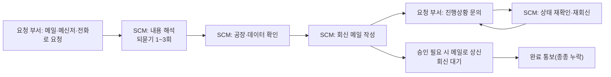
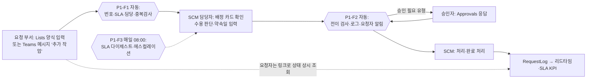
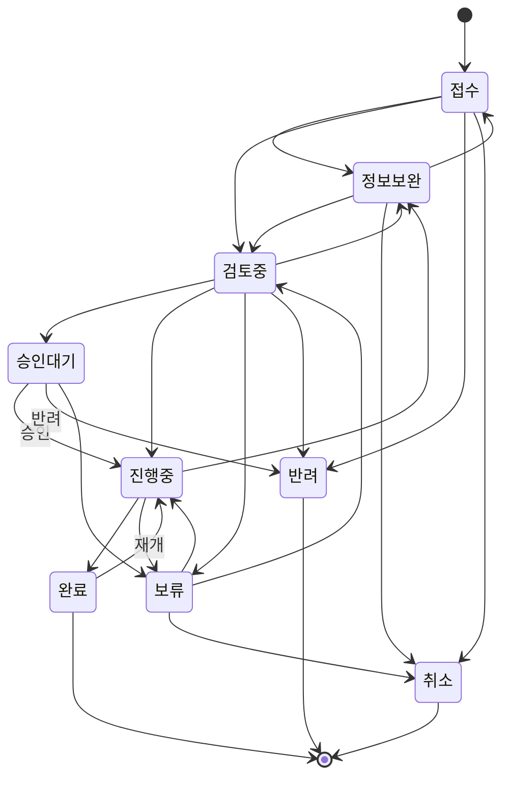

# Pilot 01 — 통합 업무요청 허브: 프로세스 설계

> 범위: O05(요청 허브) + O12(계획 변경요청·동결구간) + O29(승인 표준화). **기존 시제품 요청 Lists를 확장**하며 새 시스템을 만들지 않는다.
> 상태: 설계·코드·테스트 완료(로컬, 모의 데이터). **M365 테넌트 배포는 미실시** — 배포 절차는 `implementation_guide.md`.

## 1. 목표와 성공 기준

| 목표 | 측정 | 목표치(파일럿 4주) |
|---|---|---|
| 요청 1건당 SCM 처리 시간 단축 | 2주 타임 로그 표본(전·후 각 20건) | −30% |
| '진행상황 문의' 제거 | 받은편지함·채팅 표본 검색(주당) | −50% |
| 약속기한 준수 가시화 | SLA 준수율(약속일 대비 종료일) | 측정 시작 + 90% 이상 |
| 요청 정보 누락 감소 | '정보보완' 이벤트 비율 | ≤10% |

## 2. As-Is 프로세스 (가정, Phase 1 타임 로그로 검증)

| 단계 | 낭비 유형 | 건당 소요(가정) |
|---|---|---|
| 되묻기(정보 누락) | 재작업·대기 | 5~15분 |
| 진행상황 문의 응대 | 과잉처리 | 3~10분 × 1~3회 |
| 승인 메일 상신·추적 | 대기·동작 | 5~10분 |
| 기록 없음 → 리드타임·SLA 측정 불가 | 관리 부재 | - |

## 3. To-Be 프로세스

### 상태 모델

허용되지 않은 전이는 **되돌리지 않고** 로그에 '규칙위반'으로 남기고 담당자에게 알린다(사람의 의도를 흐름이 덮어쓰지 않기 위해).

## 4. 자동화 구간 vs 사람 개입 구간

| 단계 | 자동(흐름) | 사람 | 근거 |
|---|---|---|---|
| 접수번호·SLA 목표일·기본 담당자 | ● | | 규칙으로 결정 가능 |
| 중복 의심 탐지 | ● 탐지·표시 | ● 병합 여부 판단 | 오탐 가능 → 자동 병합 금지 |
| 수용 여부·약속 완료일 | | ● | 공장 Capa·우선순위 판단 필요 |
| 상태 전이 검사·로그 | ● | | |
| 승인 | ● 요청·기록 | ● 승인/반려 | 권한 행위 |
| 약속일 변경 사유 | ● 누락 시 요청 | ● 사유 기재 | 책임 추적 |
| SLA 경고·에스컬레이션 | ● | ● 재협의 | |
| 요청자 알림 | ● | | |

## 5. 프로세스별 예상 효과 (가정)

| 개선 지점 | 건당 절감(가정) | 근거 메커니즘 |
|---|---|---|
| 필수 항목 양식 + SLAPolicy.RequiredFields 검사 | 4분 | 되묻기 제거 |
| 요청자 상태 셀프 조회 + 변경 알림 | 5분 | 진행 문의 제거 |
| 승인 Approvals 표준화 | 2분 | 상신·추적 메일 제거 |
| 담당자 일일 다이제스트 | 1분 | 개별 확인 제거 |
| **합계** | **12분/건 × 1,200건 × 활용률 0.8 = 192h − 유지 20h = 172h/년** | `04` O05 |

## 6. Power Automate 설계

상세 단계·식은 `automation_assets/flows_spec.json`, `automation_assets/expressions.md`. 요약:

| 흐름 | 트리거 | 핵심 액션 순서 | 조건식·변수 | 오류·재시도 | 중복·무결성 | 동시성 |
|---|---|---|---|---|---|---|
| P1-F1 접수 | SharePoint: 항목을 만든 경우 | SLAPolicy 조회 → Holidays 배열 → 접수기준일(17시 컷오프) → Do until 영업일 가산 → 중복검사 → 항목 갱신 → 로그 → 카드 | varHolidays(Array), varD(String), varAdded(Int) | 액션별 지수 재시도 4회 / Try·Catch → FlowErrorLog | ID 기반 번호(경합 없음), 중복은 표시만 | 기본 |
| P1-F2 변경 | 항목을 만들거나 수정한 경우 + 트리거 조건 2개 | 전이 검사 → 종료일·승인 분기 → 약속일 변경 처리 → 요청자 알림 → **마지막에 Prev열 동기화** | varTransitions(Object) | 동일 | Prev열 패턴으로 자기 재실행 차단, 승인 응답 후 현재 상태 재조회 | 기본(승인 대기가 큐를 막지 않도록) |
| P1-F3 SLA | 반복(평일 08:00 KST) | 휴무 확인 → 기준일 계산 → 미종료 위험 항목 조회(페이지 매김) → 담당자별 카드 1장 → 에스컬레이션 1장 | varEscalationCutoff | 동일 | 같은 날 에스컬레이션 로그 중복 금지 | Apply to each 담당자 순차 |
| P1-F4 등록 | Teams: 선택한 메시지 | 카드 입력 → 항목 생성 | - | 동일 | - | - |

**승인 대기 관리:** 'Start and wait for an approval'에 시간 제한 P7D → 시간 초과 시 승인자에게 리마인더 1회 + 로그 'SLA경고', 이후 재대기(흐름 최대 실행 기간 30일 이내). 응답 시점에 항목 상태가 이미 바뀌었으면(예: 보류) 응답을 반영하지 않고 로그만 남긴다.

**규칙의 검증:** 흐름 식과 같은 의미의 `request_hub_rules.py`를 19개 테스트로 검증(영업일·컷오프·휴무·에스컬레이션 기준일 동치성 3개월 전수 비교 포함).

## 7. 데이터 구조

`automation_assets/lists_schema.json` (5개 목록: RequestHub, RequestLog, SLAPolicy, Holidays, FlowErrorLog).

| 설계 결정 | 이유 |
|---|---|
| 고유 식별자 = SharePoint ID → REQ-yyyy-00000 | 채번 테이블·경합 불필요 |
| 상태·담당자·SLA 목표일·중복검사키 **인덱스** | 5,000건 보기 임계값 회피(파일럿 단계부터) |
| 설정을 목록으로(SLAPolicy·Holidays) | 운영 규칙 변경에 흐름 수정 불필요 |
| RequestLog 별도 | 버전 기록은 KPI 집계가 어려움 → 이벤트 로그로 리드타임 산출 |
| 접근 권한 | 요청 부서는 '본인 작성 항목만 편집'(항목 수준 권한), 로그는 읽기 전용 |

### 기존 시제품 목록 재사용 방식
1. 기존 목록의 열을 `implementation_guide.md` 2장의 매핑표에 적는다(이름·형식·사용 여부).
2. **같은 의미의 열은 이름을 바꾸지 않고 그대로 쓴다** — 흐름 식의 내부 이름만 기존 이름으로 바꾼다.
3. 없는 열만 추가한다(최소: RequestType, Status, Owner, SLATargetDate, DueDateCommitted, PrevStatus, PrevDueDateCommitted, DuplicateKey, RequestID).
4. 기존 '시제품' 데이터는 RequestType='시제품'으로 일괄 지정(Quick Edit/그리드 보기) — **대량 수정이므로 사전 백업(CSV 내보내기)과 사용자 승인 후 실행**.

## 8. 시나리오별 구현

| 시나리오 | 구성 | 제한 | 비용 |
|---|---|---|---|
| A 기본 권한 | 기존 목록 + 열 추가 + P1-F1·F3만(개인 연결), 승인은 상태+카드 | 팀 채널 게시 불가 시 개인 채팅만, 흐름이 개인 소유 | 0 |
| B 팀 협업 | 팀 사이트 5개 목록 + P1-F1~F4, Approvals, 공동 소유 | Workflows 앱 허용 필요 | 0 |
| C 고급 | + Copilot으로 요청 본문 요약·유형 추천(사람 확정), 요청 허브 데이터 기반 문의 에이전트(O13, 별도승인) | Copilot 라이선스/크레딧, 정보보안 승인 | 라이선스·크레딧 |

## 9. 위험과 대응

| 위험 | 대응 |
|---|---|
| 요청 부서가 여전히 메일로 요청 | 메일 요청은 SCM이 Teams 메시지 액션/양식으로 대신 등록하되 회신에 '다음부터는 링크로' 안내. 4주 후 메일 요청 비율 측정 |
| 알림 피로 | 담당자별 하루 1장, 요청자 알림은 상태·약속일 변경 시에만 |
| 흐름 소유자 부재 | 공동 소유자 2명, 연결 목록 문서화 |
| 날짜 형식(UTC/KST) 오류 | 첫 실행 Compose 확인 절차(`expressions.md` 4장), 테스트 TC-M05 |
