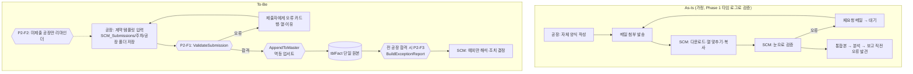

# Pilot 02 — 공장 데이터 계약·자동 검증·단일 원본: 프로세스 설계

> 범위: O04(데이터 계약) + O10(Capa 부하율) + O11의 기반(재고 커버). 이후 O06(S&OP 변경 감지)·O08(보고)·O32(KPI)가 이 원본 위에서 동작한다.
> 상태: Office Scripts 3종 strict 컴파일·모의 Workbook 테스트 15/15, Python 검증기 5/5, 두 구현 교차 검증 일치. **M365 배포 미실시.**

## 1. 핵심 아이디어 — "취합을 자동화하지 말고, 취합을 없앤다"

지금 SCM 담당자는 공장별로 다른 Excel을 받아 **사람이 변환기 역할**을 한다. 자동화 대상은 '복사·붙여넣기'가 아니라 그 원인인 **합의되지 않은 양식**이다.
1. 공장과 **데이터 계약**(14개 열, 오류 규칙 8개, 경고 2개)을 합의한다 → `automation_assets/data_contract.json`
2. 공장은 계약 템플릿에 입력해 정해진 폴더에 저장한다 — 그 순간이 '제출'이다(메일 없음).
3. 저장 즉시 서버가 검증한다. 오류는 **10분 안에** 제출자에게 행·열·이유와 함께 돌아간다. SCM은 개입하지 않는다.
4. 합격분만 마스터(tblFact)에 반영된다. 같은 주차를 다시 내면 **교체**된다(멱등).
5. 전 공장이 합격하면 예외 리포트(X01~X05)가 채널에 1장 올라온다. **SCM은 예외만 본다.**

## 2. As-Is → To-Be

| 단계 | As-Is 주당 소요(가정, 6개 공장) | To-Be | 비고 |
|---|---|---|---|
| 수신·다운로드·열 맞추기 | 90분 | 0 | 단계 소멸 |
| 검증 | 60분 | 0(예외 리포트 검토 15분) | 규칙 E01~E08 자동 |
| 재요청·대기 | 30분 + 대기 수시간~수일 | 0(공장이 즉시 자기 수정) | 오류 발견 시점이 '보고 직전' → '제출 10분 후' |
| 통합본 재가공 | 30분 | 0 | 마스터가 곧 통합본 |

## 3. 자동화 구간 vs 사람 구간

| 단계 | 자동 | 사람 |
|---|---|---|
| 형식·필수·주차·공장·SKU·숫자·중복·PSI 수지 검사 | ● | |
| 경고(조정 사유 없음, 가동>가용) | ● 표시 | ● 공장이 판단 |
| 마스터 반영 | ● | |
| 미제출 독촉 | ● | |
| 예외(연속성·급변·병목·재고커버·계획달성) 탐지 | ● | |
| **예외의 원인 해석·조치 결정** | | ● SCM |
| 데이터 계약 변경 | | ● SCM + 공장 합의(버전 증가) |

## 4. 데이터 계약 요약 (v1.0)

| 열 | 의미 | 규칙 |
|---|---|---|
| Week | ISO 주차 `2026-W44` | 형식, 제출 대상 주차와 일치(E03) |
| PlantCode | 공장코드 | 제출 폴더 공장과 일치(E04) |
| SKU, LineCode | 제품·라인 | SKU 마스터 존재(E05), 키 중복 금지(E07) |
| BeginInv, Production, Receipt, Shipment, EndInv, PlanNextWeek, RunHours, AvailHours | 수치 | 숫자·0 이상(E06) |
| Adjustment | 재고조정(±) | 0이 아니면 Remark 필요(W01) |
| Remark | 비고 | - |

**PSI 수지 규칙(E08):** `|기초 + 생산 + 이동입고 − 출하 + 조정 − 기말| ≤ max(1, 0.1% × (기초+생산+입고))` — 수치가 '맞는지'를 제출 시점에 보장한다.

**예외 규칙(마스터 기준):** X01 기초≠전주 기말(High) · X02 생산 ±30% 급변 · X03 라인 가동률 >95%(>100% High) · X04 재고 커버 >8주(과잉)/<1주(결품 위험 High) · X05 전주 계획 대비 달성률 <90%/>110%.

## 5. Power Automate 설계

`automation_assets/flows_spec.json` 참조.

| 흐름 | 트리거 | 핵심 | 오류·재시도 | 중복·무결성 | 동시성 |
|---|---|---|---|---|---|
| P2-F1 | 파일 생성·수정(속성만), 트리거 조건 `.xlsx` | Delay 60초 → ETag 중복 확인 → ValidateSubmission → (합격) AppendToMaster → SubmissionLog → 회신 | 지수 재시도, Try/Catch → FlowErrorLog | ETag+SubmissionKey로 같은 파일 재처리 방지, 업서트 멱등 | **트리거 동시성 1**(마스터 동시 쓰기 차단) |
| P2-F2 | 반복(월·화 09:00) | 미제출 공장 차집합 → 해당 공장만 알림 | 동일 | - | - |
| P2-F3 | SubmissionCalendar 상태=완료 AND ReportPostedAt 비어 있음 | BuildExceptionReport → 채널 카드 1장 → ReportPostedAt 기록 | 동일 | ReportPostedAt으로 재게시 방지 | - |

**플랫폼 한계 반영(✅ S11·S12):** Run script는 사용자당 1,600회/일 — 주 6개 공장 × 재제출 포함 최대 30회 수준이라 여유. 동기 실행 120초 — 스크립트는 일괄 읽기·쓰기(셀 단위 호출 없음), 삭제는 연속 블록 단위. 파일 25MB·응답 5MB — tblFact는 연간 약 2.5만 행(6공장 × 80행 × 52주, 가정)로 한도 내. **10만 행 또는 실행 60초 초과 시 Dataverse/DB 이전**(05 문서 4장).

## 6. Office Scripts 설계

| 스크립트 | 실행 대상 | 입력 | 출력 | 파일 변경 |
|---|---|---|---|---|
| `ValidateSubmission.ts` | 제출 파일 | expectedWeek, plantCode, validSkusCsv | ok, issues(최대 200), rowsJson | **없음(읽기 전용)** |
| `AppendToMaster.ts` | 마스터 | submissionKey, rowsJson, loadedBy | deleted/inserted/total | tblFact만 |
| `BuildExceptionReport.ts` | 마스터 | week | counts, top 15 | Exceptions 시트만 |

안전 설계: SKU 마스터가 비어 전달되면 **전체 반려(fail-closed)**, 머리글이 계약과 다르면 반영 거부, rowsJson의 키가 SubmissionKey와 다르면 거부, 한 번에 5,000행 초과 거부.

## 7. 시나리오별 구현

| 시나리오 | 구성 | 사람의 일 | 비용 |
|---|---|---|---|
| **A-lite** (흐름 사용 불가 시) | 계약 템플릿 + SharePoint 폴더 + Excel 데스크톱 **Power Query 폴더 결합**(`power_query/CombinePlantSubmissions.pq`) + `PSI_Diff`/`CheckFlag` 열 + Python in Excel 검증 셀(`python/python_in_excel_cell.py`) | SCM이 새로 고침 1회, 오류 행 필터 → 공장에 회신 | 0 |
| **B** (권장) | 위 + P2-F1~F3 + Office Scripts(SharePoint 라이브러리 저장) | 예외 해석만 | 0 |
| **C** | tblFact → Dataverse/IT DB, Power BI 데이터 모델, ERP/APS 내보내기 자동 적재(IT), Copilot in Excel로 예외 코멘트 초안 | 예외 해석·의사결정 | Premium·Power BI·Copilot |

## 8. 위험과 대응

| 위험 | 대응 |
|---|---|
| 공장의 양식 전환 저항 | 공장 입장 이점 제시: 재요청 메일 0, 즉시 피드백. 첫 2주는 기존 양식도 병행 수용(SCM이 템플릿으로 옮겨 제출) |
| 공장별 특수 항목 | 계약은 공통 14열만. 특수 항목은 Remark 또는 계약 v1.1 협의(버전 관리) |
| 해외 공장의 SharePoint 접근 | 외부 공유 정책 확인 필요(`12` 문서 Q-07). 불가 시 공장 담당자 메일 첨부 → SCM이 폴더에 저장(검증은 동일하게 자동) |
| 마스터 파일 수동 편집으로 손상 | 마스터는 읽기 전용 공유, 편집은 흐름 계정만. 버전 기록으로 복구 |
| 숫자에 천 단위 쉼표 문자열 | E06으로 반려(템플릿 데이터 유효성 검사로 예방) |
