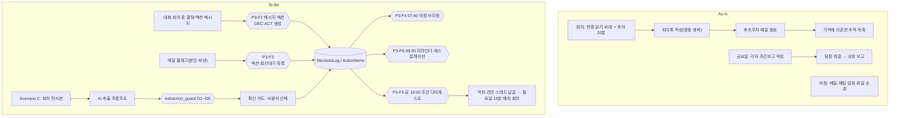

# Pilot 03 — 결정–액션 루프 + 아침 브리핑: 프로세스 설계

> 범위: O03(결정·액션 레지스터) + O15(결정 대기열) + O16(사전자료 경고) + O01(아침 브리핑) + O02(메일 플래그) + **제거 패키지 O14(현황회의)·O17(주간보고)**.
> 상태: 브리핑 규칙·AI 추출 가드 10/10 테스트 통과, 카드·에이전트 설정 작성 완료. **M365 배포 미실시.**
> 성공 조건: 도구 구축 + **팀장의 '정례 현황회의 축소·주간보고 폐지' 결정**(`12` D-03). 결정 없이 도구만 만들면 효과의 약 44%(O14·O17 몫 298h)가 사라진다.

## 1. 핵심 아이디어 — "회의록을 잘 쓰는 것이 아니라, 결정이 데이터가 되게 한다"

- 회의의 산출물은 회의록이 아니라 **결정(DEC)과 액션(ACT)** 이다. 이 둘이 목록의 행이 되면 회의록·주간보고·현황회의가 필요 없어진다.
- 입력 비용을 0에 가깝게: Teams 메시지 '추가 작업' 클릭 → 카드 1장 → 등록. 메일은 **플래그만** 하면 액션이 된다.
- 사람은 아침에 **카드 1장**만 본다. 거기에는 기한 초과·오늘 마감·나의 결정 대기·SLA 위험이 점수 순으로 5개.
- AI(Scenario C)는 회의록에서 후보를 뽑지만 **등록은 사람이 고른 것만**, 그리고 AI가 쓴 근거 문장이 원문에 실제로 있는지 코드가 검사한다.

## 2. As-Is → To-Be

## 3. 자동화 구간 vs 사람 구간

| 단계 | 자동 | 사람 | 비고 |
|---|---|---|---|
| 결정·액션 등록 | ● 카드·번호·근거 링크 저장 | ● 클릭·분류·담당자 지정 | 메시지 원문이 근거로 남음 |
| 메일 → 액션 | ● | ● 플래그만 | 본문 전체·첨부 저장 안 함 |
| 결정 요청 → 대기열 | ● 경과일 표시 | ● **결정** | 결정 대기시간 KPI |
| 리마인더 | ● 담당자별 하루 1장 | | 같은 날 중복 금지 |
| 에스컬레이션 | ● 3회 초과 시 결정권자 주 1회 | ● 조치 | |
| 아침 우선순위 | ● 점수 Top 5 | ● **오늘 할 일 선택** | 점수는 제안일 뿐 |
| 주간 현황 | ● 다이제스트 | ● 막힌 건만 답글 | 주간보고 대체 |
| AI 추출(C) | ● 후보·검사 | ● **채택 선택** | 자동 등록 금지 |

## 4. 아침 브리핑 점수 규칙 (`python/daily_brief.py` SCORE와 흐름 식이 동일해야 함)

| 항목 | 점수 | 예 |
|---|---|---|
| 기한 초과 액션 | 100 + 5 × 초과일 | 4일 초과 = 120 |
| SLA 초과 요청(Pilot 01) | 90 | |
| 나의 결정 대기 | 70 + 3 × 대기일 | 6일 = 88 |
| 오늘 마감 액션 | 80 | |
| SLA 임박 요청 | 60 | |
| 회신 대기(보낸 메일 플래그 기한 경과) | 40 + 2 × 경과일 | |

부가 정보: 집중 가능 시간(09–18시 빈 60분 이상), 오늘 회의 수·시간, **안건 링크 없는 내 주관 회의 경고**(O16). 카드 크기는 Teams 한도(약 28KB) 이하로 검증.

## 5. Power Automate 설계 요약 (`automation_assets/flows_spec.json`)

| 흐름 | 트리거 | 핵심 | 중복·무결성 | 오류 |
|---|---|---|---|---|
| P3-F1 | Teams 선택 메시지 | 카드 입력 → 사용자 실존 확인 → DEC/ACT 생성 | SourceMessageId로 같은 메시지 재등록 차단 | Try/Catch |
| P3-F2 | 항목 생성·수정 + 트리거 조건 | 번호 부여, 완료일 기록, Prev 동기화 | Prev열 패턴 | 동일 |
| P3-F3 | 메일 플래그 지정(V4), 받은·보낸 편지함 | 실행/회신대기 액션 생성 | SourceMessageId(메일 ID) | 동일 |
| P3-F4 | 평일 07:40 | 일정·액션·결정·요청 조회 → 점수 → 카드 | 읽기 전용 | 동일 |
| P3-F5 | 금 16:00 | 주간 집계 → 채널 카드 | 읽기 전용 | 동일 |
| P3-F6 | 평일 08:30 | 담당자별 리마인더, 에스컬레이션 | LastRemindedAt으로 같은 날 중복 금지 | 동일 |

## 6. AI Agent 설계 (Scenario C)

### 6.1 회의 결정·액션 추출기
| 항목 | 내용 |
|---|---|
| 역할 | 회의 전사본·메모에서 결정·액션 후보 JSON 생성 |
| 참조 데이터 | 해당 회의 전사본(Teams 전사 또는 Copilot 회의 요약) + 참석자 명부 |
| System Instructions | `agent/meeting_extractor_instructions.md` |
| Tools·Actions | 없음(텍스트 → JSON). 등록은 Flow가 사람 선택 후 수행 |
| 실행 조건 | 회의 종료 후 주관자가 실행(수동) — 자동 실행은 파일럿 합격 후 검토 |
| 사용자 확인 필요 | **모든 등록**(확인 카드 `cards/ai_extraction_confirm.json`) |
| 응답 구조 | `{decisions:[{text,decided_by,evidence}], actions:[{title,owner_name,due_date,due_text,decision_ref,evidence}]}` |
| 환각 방지 | G2 근거 원문 일치(공백 정규화 후 부분 문자열, 8자 이상) · G3 명부 매핑(이메일 생성 금지, 동명이인 시 미확정) · G4 기한 근거 표현 필수·범위 검사 · G5 중복 제거 · G6 결정 참조 유효성 — `python/extraction_guard.py` |
| 품질 기준 | 근거 일치율 ≥95%, 지어낸 기한 0건, 담당자 오지정 ≤5%, 누락률 ≤15% (20개 회의 측정) |

### 6.2 결정 조회 에이전트 (Decision Assistant)
`agent/decision_assistant_instructions.md`(설정서), `agent/instructions.txt`(지침 원문), `agent/declarativeAgent.json`(Agents Toolkit용), `agent/eval_cases.json`(12문항, 합격선 10/12·환각 0·모름 3/3). 읽기 전용, 출처 필수, 모르면 "찾지 못했습니다".

## 7. 시나리오별 구현

| 시나리오 | 구성 | 제한 | 비용 |
|---|---|---|---|
| A | ActionItems 1개 목록 + P3-F3(메일 플래그) + P3-F4(브리핑, 액션·일정만) — 개인용 | 결정 레지스터·팀 다이제스트 없음 | 0 |
| B | 두 목록 + P3-F1~F6 + 회의·보고 제거 규칙 | Workflows 앱 허용, 팀 사이트 | 0 |
| C | + AI 추출기(Copilot Chat/Studio) + 결정 조회 에이전트 + Copilot 예약 프롬프트로 받은편지함 요약 | Copilot 라이선스, 회의 전사 정책, 정보보안 승인 | 라이선스·크레딧 |

## 8. 위험과 대응

| 위험 | 대응 |
|---|---|
| 등록 습관이 안 붙음 | 회의 종료 2분 전 '결정·액션 기록 시간' 고정, 주관자 책임 |
| 리마인더 피로 | 하루 1장, 기한 D-1부터만 |
| 회의 폐지 저항 | 4주 실험으로 제안(되돌릴 수 있음), 다이제스트 품질을 먼저 보여준다 |
| 민감 결정 노출 | DecisionLog 읽기 범위를 SCM+S&OP 참여자로 제한, 인사·계약 사안 등록 금지 |
| AI 오류 | 가드 + 사람 선택 + 합격선 미달 시 Scenario B 유지 |
